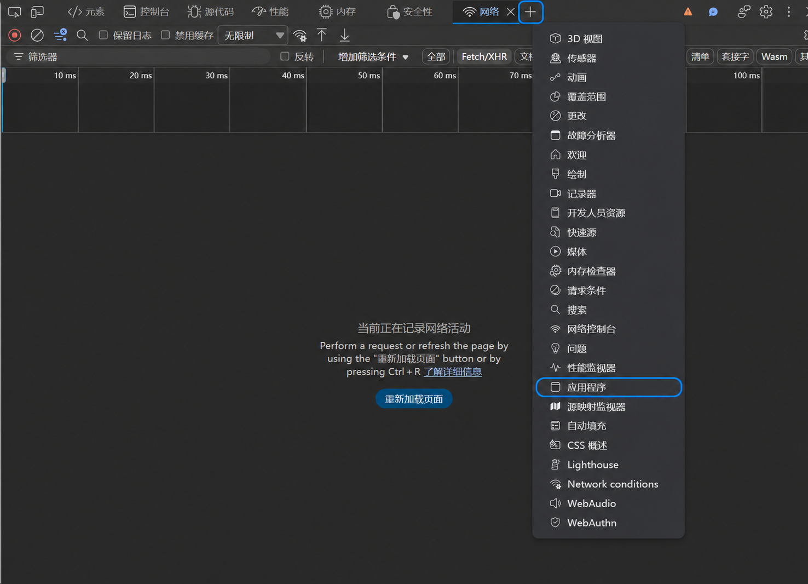
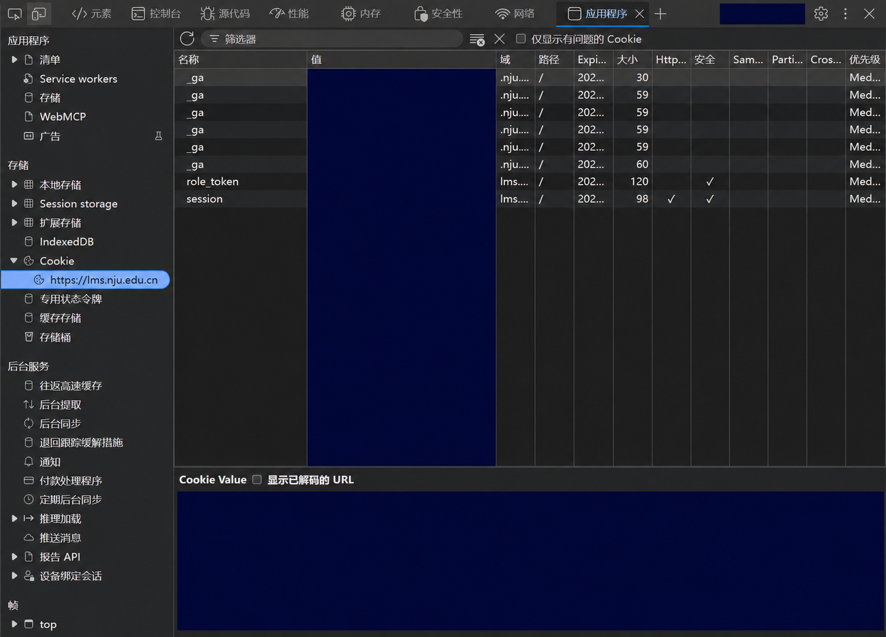

# 从“应用程序”获取 Cookie

本指南适用于 Edge / Chrome。Cookie 请从自己的登录会话复制，只用于本地下载工具。

## 1. 打开开发者工具

1. 在浏览器打开 https://lms.nju.edu.cn/user/courses#/，正常登录，确认能看见自己的课程。
2. 按 **F12**，笔记本可能需要 **Fn+F12**；也可以按 **Ctrl+Shift+I**。
3. 若快捷键不可用：浏览器右上角 **⋯ / ⋮ → 更多工具 → 开发者工具**。

## 2. 找到“应用程序”

- 在开发者工具顶部的标签栏点击 **应用程序 / Application**。这是开发者工具的标签，不是浏览器的应用商店或电脑的“设置 → 应用”。
- 顶部没显示时，点标签栏右侧 **»（更多标签）**，在隐藏标签中选择“应用程序”。可先加宽开发者工具区域。
- 仍找不到时，在开发者工具右上角 **⋮ → 更多工具 / More tools → 应用程序 / Application** 打开。
- 也可在开发者工具中按 **Ctrl+Shift+P**，输入 **Show Application**（或“应用程序”），选择显示 Application 面板的命令。

部分版本可直接点击开发者工具标签栏的 **+**，在弹出菜单中选择“应用程序”，如下图。蓝框标出两个位置：



## 3. 选择学校站点的 Cookie 表格

1. 在“应用程序”左侧找到 **存储 / Storage** 分组。
2. 点击 **Cookie / Cookies** 左侧的小三角展开。
3. 选择 **https://lms.nju.edu.cn**。
4. 右侧应显示包含“名称、值、域、路径”等列的 Cookie 表格。确认筛选框为空，未勾选“仅显示有问题的 Cookie”。

若没有学校站点，先回到学校网页完成登录并刷新，再查看此列表。不要选择其他网站或登录跳转页的 Cookie。

下面的截图保留学校域名、Cookie 名称和 Cookie Value 位置；所有值、统计标识与底部明文均已遮盖。桌面应用内可点击图片放大查看：



## 4. 复制并粘贴

### 方式 A：复制整张表格

1. 点击右侧 Cookie 表格中的一行，让焦点落在表格中。
2. 按 **Ctrl+A** 选择表格行，再按 **Ctrl+C** 复制。
3. 回到应用，粘贴到 Cookie 输入框。正确结果通常是多行内容，每行包含名称、值、域、路径等列，而不是网页正文或截图。
4. 桌面应用点击“验证并探测全部课程”。命令行工具则将文本保存到脚本旁的 **cookie.txt**（UTF-8），再运行 `python decode.py`。

浏览器版本可能影响表格复制行为。如果只复制到一项或不能复制整表，请使用方式 B，不必安装扩展。

### 方式 B：逐项复制登录 Cookie

1. 在表格中找到 **session**，单击该行。
2. 在底部 **Cookie Value** 区域复制完整值；如果没有底部区域，可使用该行的复制值菜单或展开/查看“值”单元格。不要手工照抄显示为 `…` 的截断文本。
3. 如果列表里有 **role_token**，同样复制它的完整值。
4. 按下面的名称与值形式拼接，粘贴进应用输入框或保存到 cookie.txt：

```text
session=这里替换为完整session值; role_token=这里替换为完整role_token值
```

如果没有 role_token，先使用完整的 `session=实际值` 验证；如果验证失败，重新登录后优先复制完整表格。不要直接粘贴不带名称的单个值，也不要只复制 `_ga` 等统计项。示例文字不能用于登录。

## 5. 常见问题

| 现象 | 处理 |
| --- | --- |
| 不知道“应用程序”在哪里 | 它在 F12 打开的开发者工具中；检查隐藏标签 » 或“更多工具” |
| Cookie 列表没有学校域名 | 先正常登录并刷新“我的课程”，再展开 Cookies |
| 只看到几条或看不到 session | 清空筛选框、取消“仅显示有问题的 Cookie”，确认选中 lms.nju.edu.cn |
| 粘贴后是网页正文或只有一项 | 焦点可能未落在表格，改用逐项复制方式 |
| 值中出现省略号 | 从底部 Cookie Value 复制完整值，不照抄截断文本 |
| 提示登录失效 | 在浏览器重新登录，清空应用旧内容后重新复制 |

Cookie 相当于登录凭证，不要公开分享或放进 GitHub。交互设计原型不处理真实登录，请勿向原型粘贴真实 Cookie。教程与 EXE 只使用已脱敏的截图衍生文件，不包含用户提供的原始截图。
